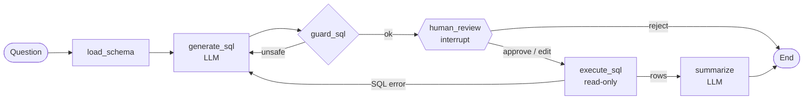

# Roaming Insights Agent

**Ask questions about international roaming data in plain English. Get reviewed SQL, a chart and a short answer.**

A GenAI analytics agent built with **LangGraph**. It turns a question like *"Which partners have the highest LTE attach failure rate?"* into a SQLite query. A **human analyst approves, edits or rejects** the query before it runs. The agent then executes it read-only and explains the result.

The data models a telecom roaming / IREG team: roaming partners, IREG test results (IR.24 GSM, IR.35 GPRS, IR.38 LTE, plus VoLTE) and monthly roaming traffic and revenue. **All data is synthetic** and every operator name and TADIG code is fictional.

---

## Why this project

Roaming and IREG teams answer the same ad-hoc questions every week: failure rates by partner, top failure causes, traffic trends. Today that means writing SQL or rebuilding Excel pivots. This agent lets anyone ask in plain English. A human stays in control of every query that touches the database.

## Features

| Area | What it does |
|---|---|
| **Text-to-SQL** | An LLM writes SQLite from the schema plus sample rows, guided by domain rules (failure-rate definition, date formats, joins). |
| **Human-in-the-loop** | A LangGraph `interrupt()` pauses the graph so the reviewer can **approve / edit / reject**. Nothing runs without approval. |
| **Guardrails** | Only single `SELECT`/`WITH` statements pass. Write and DDL keywords, `PRAGMA` and `ATTACH` are blocked. An automatic `LIMIT` is added, the DB connection is read-only, and slow queries time out. |
| **Self-correction** | If SQL fails (bad column, syntax), the error goes back to the LLM, which retries up to 3 times. |
| **Audit trail** | Every review decision and executed query is appended to `logs/audit.jsonl`. |
| **Evaluation** | `eval/run_eval.py` measures **execution accuracy** against a golden set of questions with reference SQL. |
| **Any model** | OpenAI, Anthropic Claude, or a local Ollama model, through LangChain's `init_chat_model`. |
| **UI** | Streamlit app with an editable SQL review box, auto chart (Plotly) and results table. There's also a CLI. |

## Architecture



```
roaming-insights-agent/
├── agent/
│   ├── graph.py       # LangGraph wiring + Session helper (interrupt / resume)
│   ├── nodes.py       # node logic + routing (pure functions, unit-tested)
│   ├── sql_guard.py   # read-only SQL guardrails
│   ├── prompts.py     # system prompts with roaming domain rules
│   ├── db.py          # read-only SQLite access, schema introspection, timeouts
│   ├── audit.py       # JSONL audit log
│   └── llm.py         # model factory (OpenAI / Anthropic / Ollama)
├── data/generate_data.py   # synthetic partners, IREG tests, traffic
├── eval/                   # golden questions + execution-accuracy eval
├── tests/                  # pytest suite with a fake LLM (no API key needed)
├── app.py                  # Streamlit UI
└── cli.py                  # terminal UI
```

## Quick start

```bash
git clone https://github.com/Pranil1599/roaming-insights-agent.git
cd roaming-insights-agent
python -m venv .venv && source .venv/bin/activate     # Windows: .venv\Scripts\activate
pip install -r requirements.txt

python data/generate_data.py        # creates data/roaming.db
cp .env.example .env                # add your API key + choose a model

streamlit run app.py                # web UI
# or
python cli.py "Top 5 partners by LTE attach failure rate"
```

Run the tests (no API key needed):

```bash
pytest -q
```

Run the eval (uses your model):

```bash
python eval/run_eval.py --model openai:gpt-4o-mini
```

## Example questions

- Which 5 partners have the highest LTE attach failure rate?
- What are the most common failure causes for VoLTE tests?
- Monthly outbound data traffic in GB for African partners
- Which partners in Testing status failed IR.38 tests in the last 60 days?
- Revenue per hub for Q2 2026

## Data model

| Table | Key columns |
|---|---|
| `partners` | `tadig`, `operator_name`, `country`, `region`, `mcc`, `mnc`, `hub`, `agreement_status` |
| `ireg_tests` | `partner_tadig`, `test_date`, `direction`, `service`, `test_case`, `result`, `failure_cause` |
| `roaming_traffic` | `month`, `partner_tadig`, `direction`, `data_mb`, `voice_min`, `sms_count`, `revenue_usd` |

## Results

<!-- Run eval/run_eval.py and paste your numbers here, e.g.: -->
| Model | Execution accuracy (8 golden questions) |
|---|---|
| _your model_ | _run the eval_ |

## Roadmap

- [ ] Add more golden questions (target 30+) and track accuracy per model
- [ ] Few-shot examples retrieved from approved queries in the audit log (learning from reviewers)
- [ ] Power BI export of approved query results
- [ ] Connect to PostgreSQL instead of SQLite

## Credits

Built by **Pranil Sonawane**. The design follows public patterns from the [LangChain SQL agent tutorial](https://python.langchain.com/docs/tutorials/sql_qa/) and the [LangGraph human-in-the-loop docs](https://docs.langchain.com/oss/python/add-human-in-the-loop). Inspired by open-source text-to-SQL projects such as [IshaanLabs/langgraph-text-to-sql-agent](https://github.com/IshaanLabs/langgraph-text-to-sql-agent).

## License

MIT
